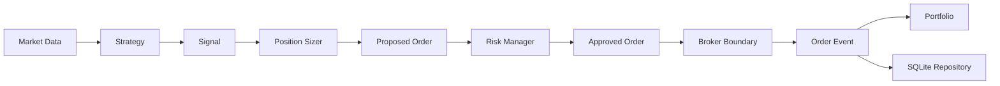

# OKX Quant Framework

一个精简、高内聚、以第一性原理安全边界和可复现回测为核心的 OKX 现货量化交易与投研框架。

项目支持离线回测（`ohlc_limit_v2` 限价撮合）、公共行情下载与实时观察、经过 4 条硬护栏保护的 OKX Demo 模拟盘与双重显式开关受控 LIVE 实盘执行（含常驻循环与未成交挂单自动撤单管理），以及离线个人投研与风险管理工具。

> 风险声明：本项目默认运行在 `backtest` / `demo` 模式（`ALLOW_LIVE_TRADING=false`）。只有在同时显式设置 `TRADING_MODE=live`、`ALLOW_LIVE_TRADING=true`、`exchange.simulated=false` 且传入 `--confirm-live-trading` 时才允许启用实盘限价单。

## 核心能力

- **配置驱动**：YAML 与环境变量合并，环境变量优先。
- **策略注册**：
  - `ma_bollinger_pullback`：均线趋势过滤（SMA/EMA + 趋势容忍带）+ 布林带回调（可选右侧企稳确认）+ ATR 动态波动率止损 / 固定止损 / 时间止损。
  - `moving_average_cross`：快慢均线交叉策略。
  - `vwap_mean_reversion`：24 根 1H VWAP 与 RSI 均值回归策略。
  - `buy_and_hold`：基准买入持有策略。
- **量化仓位管理（Position Sizing）**：
  - `fixed_notional`：固定名义金额。
  - `percent_equity`：按账户当前总权益比例动态定仓。
  - `risk_per_trade`：以损定仓（按单笔风险预算比例与策略动态止损距离自动反推仓位，并受最大仓位上限与可用余额保护）。
- **无未来函数回测（`ohlc_limit_v2`）**：收盘确认生成限价单，下一根 K 线起撮合；处理挂单保留、成交量参与度上限、盘中保护性止损/跳空与完整平仓统计（`closed_trades.csv`）。
- **极简 Demo 安全护栏（4 条硬边界）**：
  1. `TRADING_MODE` + `ALLOW_LIVE_TRADING=false` 双重 fail-closed 开关；
  2. 所有 OKX 私有请求固定发送 `x-simulated-trading: 1`；
  3. 唯一 `clOrdId` + 网络超时标记 `UNKNOWN` 落库，禁止盲目重发；
  4. 启动先同步账户与挂单、执行前后强制 `reconcile_private_state` 对账，风控否决权不可绕过。
- **机构级执行与组合扩展**：
  - **交易所端条件算法止损单（Exchange-Side Algo Stop-Loss）**：买入成交且策略信号携带 `stop_price` 时，自动向 OKX `/api/v5/trade/order-algo` 挂载服务端条件触发止损单（`triggerPxType=last`），平仓卖出前自动撤销在途条件止损单，防范本机断网/停机尾部风险。
  - **多币种共享资金池组合引擎（Multi-Asset Shared-Equity Portfolio）**：支持 `market.instruments: ["BTC-USDT", "ETH-USDT", "SOL-USDT"]` 时间戳对齐步进回测（`portfolio-backtest`）与 `run-demo` / `run-live --loop` 多币种轮询守护，共享同一 `Portfolio` 现金池与 `RiskManager` 组合总敞口/日内亏损/最大回撤熔断。
  - **BBO 微观盘口 Maker `POST_ONLY` 定价**：支持根据 OKX 实时最优买一/卖一（`bid_px` / `ask_px`）与 `maker_price_offset_bps` 自动贴盘口挂单，并以 `ordType="post_only"` 确保只做 Maker 不误吃 Taker 手续费。
  - **企业微信（WeCom）实时 Webhook 告警推送**：通过 `EventBus` 事件驱动监听订单提交/成交/撤单、条件止损挂载、风控熔断拦截与对账漂移故障，支持 `INFO / WARNING / CRITICAL` 分级过滤、密钥自动脱敏与 `test-alert` 一键连通性测试。
- **离线个人投研工具链**：每日交易参考日报、长周期现货持仓分析、Decimal 个人持仓台账、现货投资逻辑登记与复核、个人组合风险分析。

## 架构概览



`TradingEngine` 只依赖领域接口，不直接耦合 OKX REST/WebSocket、CLI 或环境变量；[app/bootstrap.py](app/bootstrap.py) 作为组合根统一组装数据源、策略、仓位器、风控、Broker 与存储。

## 快速开始

### 1. 安装与环境

要求 Python 3.11 或 3.12 及 [uv](https://docs.astral.sh/uv/)：

```powershell
uv sync --extra dev
Copy-Item .env.example .env
uv run python -m app.cli --help
```

### 2. 查看与验证策略及配置

```powershell
uv run python -m app.cli list-strategies
uv run python -m app.cli describe-strategy ma_bollinger_pullback
uv run python -m app.cli validate-config --config configs/btc_ma_bollinger_backtest.yaml
uv run python -m app.cli show-config --config configs/btc_ma_bollinger_backtest.yaml
```

主要配置文件：
- `configs/btc_ma_bollinger_backtest.yaml`：BTC-USDT 1h 均线趋势过滤 + 布林带回调 + ATR 动态止损 + `risk_per_trade` 以损定仓回测。
- `configs/btc_ma_backtest.yaml`：BTC-USDT 5m 均线交叉回测。
- `configs/btc_vwap_backtest.yaml`：BTC-USDT 1h VWAP 均值回归回测。
- `configs/eth_buy_hold_backtest.yaml`：ETH-USDT 买入持有基准回测。
- `configs/btc_ma_demo.yaml`：受控 Demo SPOT/cash 配置。

### 3. 下载行情与运行回测

```powershell
uv run python -m app.cli download-data --config configs/btc_ma_bollinger_backtest.yaml
uv run python -m app.cli backtest --config configs/btc_ma_bollinger_backtest.yaml
```

回测报告、资金曲线与成交明细输出到 `data/results/.../<run_id>/`。

### 4. OKX 公共观察与受控 Demo 模拟盘

只读公共 WebSocket K 线观察（无需 API Key，不产生订单）：

```powershell
uv run python -m app.cli observe-demo --config configs/btc_ma_demo.yaml --max-events 1 --timeout-seconds 30
```

使用 OKX Demo 模拟盘 API Key 时，先测试连接与账户同步：

```powershell
uv run python -m app.cli check-okx-connection --config configs/btc_ma_demo.yaml
uv run python -m app.cli sync-demo-account --config configs/btc_ma_demo.yaml
```

运行 Demo 策略评估（默认只读干跑，仅对账与评估信号，不发单）：

```powershell
uv run python -m app.cli run-demo --config configs/btc_ma_demo.yaml
```

显式确认在最新一根已确认收盘 K 线上向 OKX 模拟盘提交通过风控的受控限价单（支持 `--loop` 常驻守护与新信号前自动撤销未成交旧挂单）：

```powershell
uv run python -m app.cli run-demo --config configs/btc_ma_demo.yaml --execute-demo-orders --confirm-demo-order
uv run python -m app.cli run-demo --config configs/btc_ma_demo.yaml --execute-demo-orders --confirm-demo-order --loop --poll-interval-seconds 60
```

双重显式开关（`TRADING_MODE=live` + `ALLOW_LIVE_TRADING=true`）受控实盘评估与常驻循环执行：

```powershell
# 1. 仅做实盘账户对账与最新 K 线信号评估（不发单）
$env:TRADING_MODE="live"; $env:ALLOW_LIVE_TRADING="true"
uv run python -m app.cli run-live --config configs/btc_ma_bollinger_live.yaml

# 2. 显式授权实盘常驻守护（自动对账、撤除旧未成交挂单、同一根 K 线去重不重复发单、额度受 YAML risk.max_order_notional 约束）
uv run python -m app.cli run-live --config configs/btc_ma_bollinger_live.yaml --execute-live-orders --confirm-live-trading --loop --poll-interval-seconds 60
```

查询或撤销受控模拟盘订单：

```powershell
uv run python -m app.cli query-demo-order <CLIENT_ORDER_ID> --config configs/btc_ma_demo.yaml
uv run python -m app.cli cancel-demo-order <CLIENT_ORDER_ID> --config configs/btc_ma_demo.yaml --confirm-demo-cancellation
```

测试企业微信（WeCom）群机器人实时告警推送（需在 `.env` 配置 `ALERT_WEBHOOK_URL` 或通过 `--webhook-url` 传入）：

```powershell
uv run python -m app.cli test-alert --config configs/btc_ma_bollinger_live.yaml
```

## 个人投研与风险管理工具

- **一键投研与量化风控驾驶舱（新增）**：
  - 在线拉取 OKX 公共行情一键整合「台账估值 + 投资逻辑 + 组合风控 + 均线布林带 ATR 信号与以损定仓面板」：
    ```powershell
    uv run python -m scripts.personal_cockpit --fetch-public
    ```
  - 离线结合本地台账、投资逻辑库与本地 K 线生成全景 Markdown 简报：
    ```powershell
    uv run python -m scripts.personal_cockpit --ledger data/personal-positions/ledger.db --thesis-db data/personal-theses/theses.db --candles-dir data/candles
    ```
- **每日交易参考日报**（已融合 `EMA200 + BB48 + 3×ATR24` 与以损定仓量化面板）：运行 `.\scripts\run_daily_reference.ps1`，说明见 [docs/daily-reference-model.md](docs/daily-reference-model.md)。
- **长周期持仓分析**：`uv run python -m scripts.review_positions`，说明见 [docs/position-review.md](docs/position-review.md)。
- **本地个人持仓台账**：`uv run python -m scripts.personal_ledger`，说明见 [docs/personal-ledger.md](docs/personal-ledger.md)。
- **现货逻辑登记与复核**：`uv run python -m scripts.spot_thesis`，说明见 [docs/spot-thesis.md](docs/spot-thesis.md) 与 [docs/personal-trading-policy.md](docs/personal-trading-policy.md)。
- **个人组合风险分析**：`uv run python -m scripts.personal_risk`，说明见 [docs/personal-risk.md](docs/personal-risk.md)。

## 质量门验证

```powershell
uv run python scripts/quality_gate.py
```

依次执行：`ruff format --check .` → `ruff check .` → `mypy`（strict）→ 全量 `pytest` → 安全边界 `SECURITY_SMOKE`。

## 进一步阅读

- [架构说明](docs/architecture.md)
- [安全约束](docs/SAFETY_CONTRACT.md)
- [回测成交与盈亏口径](docs/backtest-correctness.md)
- [账户与对账模型](docs/account-model.md) / [对账机制](docs/reconciliation.md)
- [订单状态机](docs/order-state-machine.md)
- [CI 说明](docs/ci.md)
