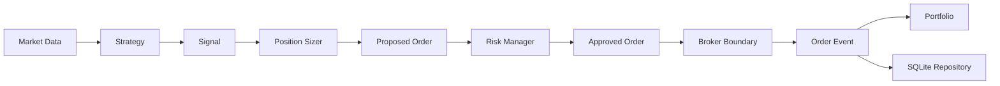

# OKX Quant Framework

一个精简、高内聚、以第一性原理安全边界和可复现回测为核心的 OKX 现货量化交易与投研框架。

项目支持离线回测（`ohlc_limit_v2` 限价撮合）、公共行情下载与实时观察、经过 4 条硬护栏保护的 OKX Demo 模拟盘执行，以及离线个人投研与风险管理工具。它不支持实盘交易，`ALLOW_LIVE_TRADING` 固定为 `false`。

> 风险声明：本项目仅用于量化工程研究和 OKX 模拟盘验证，不构成投资建议。默认不要放入任何实盘凭证；`ALLOW_LIVE_TRADING` 必须保持为 `false`。

## 核心能力

- **配置驱动**：YAML 与环境变量合并，环境变量优先。
- **策略注册**：
  - `ma_bollinger_pullback`：均线趋势过滤（SMA/EMA + 趋势容忍带）+ 布林带回调（可选右侧企稳确认）+ ATR 动态波动率止损 / 固定止损 / 时间止损。
  - `moving_average_cross`：快慢均线交叉策略。
  - `vwap_mean_reversion`：24 根 1H VWAP 与 RSI 均值回归策略。
  - `buy_and_hold`：基准买入持有策略。
- **量化仓位管理（Position Sizing）**：
  - `fixed_notional`：固定名义金额。
  - `percent_equity`：按账户当前总权益比例动态定仓。
  - `risk_per_trade`：以损定仓（按单笔风险预算比例与策略动态止损距离自动反推仓位，并受最大仓位上限与可用余额保护）。
- **无未来函数回测（`ohlc_limit_v2`）**：收盘确认生成限价单，下一根 K 线起撮合；处理挂单保留、成交量参与度上限、盘中保护性止损/跳空与完整平仓统计（`closed_trades.csv`）。
- **极简 Demo 安全护栏（4 条硬边界）**：
  1. `TRADING_MODE` + `ALLOW_LIVE_TRADING=false` 双重 fail-closed 开关；
  2. 所有 OKX 私有请求固定发送 `x-simulated-trading: 1`；
  3. 唯一 `clOrdId` + 网络超时标记 `UNKNOWN` 落库，禁止盲目重发；
  4. 启动先同步账户与挂单、执行前后强制 `reconcile_private_state` 对账，风控否决权不可绕过。
- **离线个人投研工具链**：每日交易参考日报、长周期现货持仓分析、Decimal 个人持仓台账、现货投资逻辑登记与复核、个人组合风险分析。

## 架构概览



`TradingEngine` 只依赖领域接口，不直接耦合 OKX REST/WebSocket、CLI 或环境变量；[app/bootstrap.py](app/bootstrap.py) 作为组合根统一组装数据源、策略、仓位器、风控、Broker 与存储。

## 快速开始

### 1. 安装与环境

要求 Python 3.11 或 3.12 及 [uv](https://docs.astral.sh/uv/)：

```powershell
uv sync --extra dev
Copy-Item .env.example .env
uv run python -m app.cli --help
```

### 2. 查看与验证策略及配置

```powershell
uv run python -m app.cli list-strategies
uv run python -m app.cli describe-strategy ma_bollinger_pullback
uv run python -m app.cli validate-config --config configs/btc_ma_bollinger_backtest.yaml
uv run python -m app.cli show-config --config configs/btc_ma_bollinger_backtest.yaml
```

主要配置文件：
- `configs/btc_ma_bollinger_backtest.yaml`：BTC-USDT 1h 均线趋势过滤 + 布林带回调 + ATR 动态止损 + `risk_per_trade` 以损定仓回测。
- `configs/btc_ma_backtest.yaml`：BTC-USDT 5m 均线交叉回测。
- `configs/btc_vwap_backtest.yaml`：BTC-USDT 1h VWAP 均值回归回测。
- `configs/eth_buy_hold_backtest.yaml`：ETH-USDT 买入持有基准回测。
- `configs/btc_ma_demo.yaml`：受控 Demo SPOT/cash 配置。

### 3. 下载行情与运行回测

```powershell
uv run python -m app.cli download-data --config configs/btc_ma_bollinger_backtest.yaml
uv run python -m app.cli backtest --config configs/btc_ma_bollinger_backtest.yaml
```

回测报告、资金曲线与成交明细输出到 `data/results/.../<run_id>/`。

### 4. OKX 公共观察与受控 Demo 模拟盘

只读公共 WebSocket K 线观察（无需 API Key，不产生订单）：

```powershell
uv run python -m app.cli observe-demo --config configs/btc_ma_demo.yaml --max-events 1 --timeout-seconds 30
```

使用 OKX Demo 模拟盘 API Key 时，先测试连接与账户同步：

```powershell
uv run python -m app.cli check-okx-connection --config configs/btc_ma_demo.yaml
uv run python -m app.cli sync-demo-account --config configs/btc_ma_demo.yaml
```

运行 Demo 策略评估（默认只读干跑，仅对账与评估信号，不发单）：

```powershell
uv run python -m app.cli run-demo --config configs/btc_ma_demo.yaml
```

显式确认在最新一根已确认收盘 K 线上向 OKX 模拟盘提交通过风控的受控限价单：

```powershell
uv run python -m app.cli run-demo --config configs/btc_ma_demo.yaml --execute-demo-orders --confirm-demo-order
```

查询或撤销受控模拟盘订单：

```powershell
uv run python -m app.cli query-demo-order <CLIENT_ORDER_ID> --config configs/btc_ma_demo.yaml
uv run python -m app.cli cancel-demo-order <CLIENT_ORDER_ID> --config configs/btc_ma_demo.yaml --confirm-demo-cancellation
```

## 个人投研与风险管理工具

- **每日交易参考日报**：运行 `.\scripts\run_daily_reference.ps1`，说明见 [docs/daily-reference-model.md](docs/daily-reference-model.md)。
- **长周期持仓分析**：`uv run python -m scripts.review_positions`，说明见 [docs/position-review.md](docs/position-review.md)。
- **本地个人持仓台账**：`uv run python -m scripts.personal_ledger`，说明见 [docs/personal-ledger.md](docs/personal-ledger.md)。
- **现货逻辑登记与复核**：`uv run python -m scripts.spot_thesis`，说明见 [docs/spot-thesis.md](docs/spot-thesis.md) 与 [docs/personal-trading-policy.md](docs/personal-trading-policy.md)。
- **个人组合风险分析**：`uv run python -m scripts.personal_risk`，说明见 [docs/personal-risk.md](docs/personal-risk.md)。

## 质量门验证

```powershell
uv run python scripts/quality_gate.py
```

依次执行：`ruff format --check .` → `ruff check .` → `mypy`（strict）→ 全量 `pytest` → 安全边界 `SECURITY_SMOKE`。

## 进一步阅读

- [架构说明](docs/architecture.md)
- [安全约束](docs/SAFETY_CONTRACT.md)
- [回测成交与盈亏口径](docs/backtest-correctness.md)
- [账户与对账模型](docs/account-model.md) / [对账机制](docs/reconciliation.md)
- [订单状态机](docs/order-state-machine.md)
- [CI 说明](docs/ci.md)
