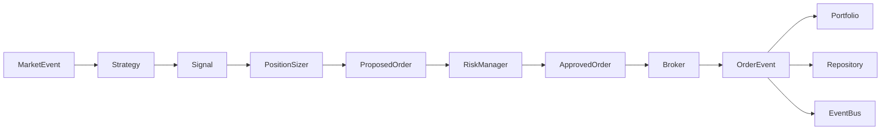

# v0.3 架构

## 核心边界

`TradingEngine` 负责从策略信号到 Broker 的通用链路。它只依赖领域接口和注入对象，不知道 OKX、REST、WebSocket、CLI、环境变量、BTC-USDT 或某个具体策略。

V3 研究候选使用现有注册表与 `StatefulStrategy` 扩展：批量研究、回测和显式只读逐根适配器
共享因果特征及状态更新；配置、对象、事件和报告绑定版本与参数。时间、预热、反馈、恢复及
旧策略兼容边界见 [统一策略契约](strategy-contract.md)。执行撮合仍由各 Runner/Broker 定义。

当前 V3 实现 `v3_step_v2` 的核心拥有跨行情/反馈的单调事件时钟，并将处理时刻保存到格式 2
checkpoint；只读适配器及恢复入口遵守同一规则，不能仅根据交易所更新时间推测处理顺序。

## 三种 Runner

- 回测 Runner：历史 Provider 输入已确认 K 线，收盘信号从下一根 K 线开始限价撮合，使用 `BacktestBroker`。订单可挂起或部分成交；保护退出按已知价位和 OHLC 处理，具体假设见 [回测口径](backtest-correctness.md)。
- 模拟盘单次评估 Runner：先同步账户和对账，再用 `ReadOnlyBroker` 计算信号、仓位和风控，绝不下单。
- 公共观察 Runner：从公共 WebSocket 接收已确认 K 线，账户风险值未知时按 fail closed 拒绝，使用 `ReadOnlyBroker`。

显式模拟盘订单由 `DemoOrderService` 组装同一个 `TradingEngine`，在确认参数、金额上限、账户同步和前置对账都通过后才注入 `OKXDemoBroker`。

阶段 5 的人工测试订单由 `DemoTradingSession` 管理。启动顺序固定为 REST 账户同步、首次对账、私有 WebSocket 登录和三类订阅确认。任何一步失败都禁止提交；私有账户和持仓推送只保存为暂态，下一次 REST 对账成功后才确认为权威状态。

## TradingSession

`TradingSession` 只处理运行开始与结束审计、异常记录、前后检查和资源关闭。它接受 `SessionRunner`、Repository、EventBus 和 Closable 列表，不导入具体交易所或回测实现。

## Instrument 评审

`Instrument` 保持为不可变、无外部访问的纯领域值对象。它虽然被多个模块使用，但没有配置加载、网络、数据库、Broker、风控或可变状态职责；继续拆分只会增加转换层，因此 v0.2 不拆。

## 基础设施

- REST：`OkxClient`，私有请求固定添加模拟交易头；
- 历史数据：CSV 或 OKX REST Provider；
- 实时数据：OKX 公共 WebSocket Provider，以及受控模拟盘私有 WebSocket Provider；
- 存储：SQLite Repository 和版本化 MigrationManager，保存余额、成本、订单来源和私有暂态快照；
- 事件：内存 EventBus，可注入持久化幂等存储；
- 组装：`app/bootstrap.py`，这是允许知道具体实现的组合根。

## 存储与命令职责

`TradingRepository` 作为显式兼容门面，委托订单成交、账户库存、提案授权、私有状态、审计运行
五个职责模块。跨表业务事务整体保留在其所有者内部，用同一个 SQLite 连接提交，门面不执行 SQL。
私有状态继续由协调器单写，Demo 写能力继续由受控服务签发。

提案复核与提交由 `DemoProposalApplication` 编排；CLI 保持参数、展示和退出码，bootstrap
上下文统一关闭这两个命令的 session/client。职责映射、事务边界、资源责任和既有跨阶段事务限制
见 [存储与 CLI 边界](storage-cli-boundaries.md)。

## 持续运行观测与事件

`RuntimeObserver` 复用现有运行事件表保存版本化观测、生命周期及合并告警；`runtime-status` 用只读
事务区分心跳新鲜、行情到达和确认 K 线处理进度，未知信息不推断为健康。观测没有交易或私有状态写权限。
持续 EventBus 在 FULL 事务中保存完整事件与幂等键后才发布，内存只保留有限尾部；有限回测保留批量审计模式。
VWAP 继续使用原逐根原子检查点，恢复增加哈希、版本、业务记录和历史 OHLCV 校验；监督者失败会传递到
等待行情的主循环。资源和 I/O 线程退出后再释放租约。操作说明与边界见 [持续运行故障处理](runtime-recovery.md)。

## 离线组合层

组合回测在原 Strategy → PositionSizer → RiskManager → Broker 链路之间增加固定分区预算，
以稳定 strategy_instance_id 绑定意图、订单、成交及策略账本。一个共享 OHLC Broker 持有唯一成交量池；
分账复用原 BacktestBroker 成本核算，账户由分账与未分配现金汇总，策略不获得共享可变账户。
PortfolioBacktestEngine 复用单策略的执行与保护退出方法，负责统一阶段、优先级和账户损失/敞口检查。
版本化 JSON 检查点以同一逻辑重放并比对状态，不增加生产数据库表、不接入 Demo 写入。
资金守恒、单策略兼容及未来受控模拟盘所需事务边界见 [离线组合回测](portfolio-backtest.md)。
